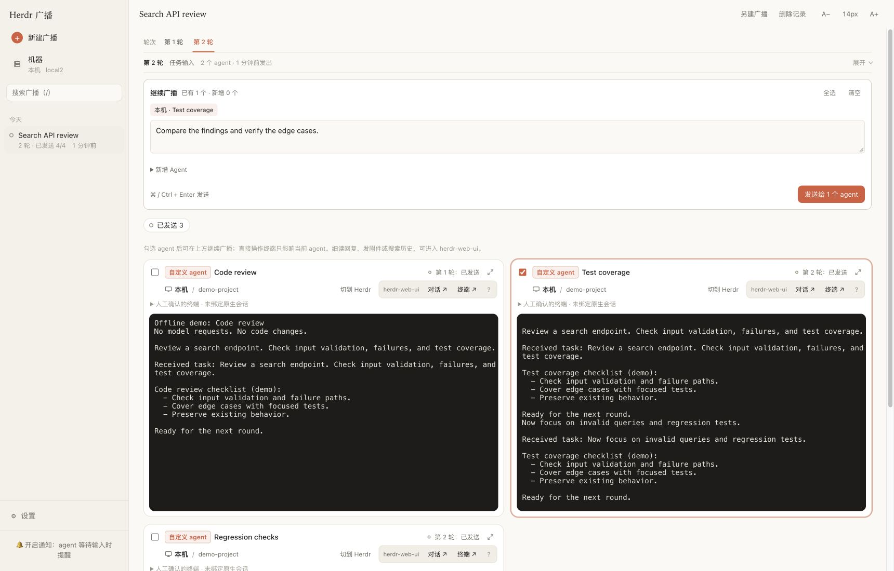

# Herdr Broadcast

**One prompt, multiple coding agents, live terminals in one browser page.**

A [Herdr](https://herdr.dev) plugin for comparing approaches, running parallel work, and continuing the conversation with the agents you choose—on your computer or saved SSH machines.

[](https://github.com/qivyn/herdr-broadcast/actions/workflows/ci.yml)

[简体中文](README.zh-CN.md) · [Releases](https://github.com/qivyn/herdr-broadcast/releases) · [Report a bug](https://github.com/qivyn/herdr-broadcast/issues/new)



*Interface example using offline demo agents. The web interface currently uses Chinese labels.*

## What you can do

- **Send the same instruction to several agents.** Try different implementations, split a task, or ask for independent reviews.
- **Continue in rounds.** Keep one task, select its existing participants, add new agents, and send the next instruction.
- **See and use live terminals.** Read output, handle startup prompts, and type into an individual agent without affecting the others.
- **Work across machines.** Use local agents and Herdr's saved SSH machines in the same task.
- **Bring your own interactive agent.** Supply a startup command when the built-in choices do not cover your tool.

Built-in choices: **Claude Code, Codex, Pi, OMP, OpenCode, Kimi, Antigravity, Grok, and Qwen**. Each machine shows which programs are available and whether session recognition is configured.

## Install

You need:

- **Linux or macOS**, with **Herdr 0.9.5+** on each participating machine.
- **Bun 1.4+** on the computer running the plugin.
- Your agent CLIs installed and signed in on the machines where they will run.
- **Python 3** where you use custom-agent process checks or history-based session recovery.

Install from GitHub and start the web page:

```sh
herdr plugin install qivyn/herdr-broadcast
herdr plugin action invoke qivyn.herdr-broadcast.web
```

Open **[http://127.0.0.1:7318](http://127.0.0.1:7318)**. If that port is occupied, check the actual address:

```sh
herdr plugin action invoke qivyn.herdr-broadcast.web-status
```

Herdr starts the page on subsequent startups unless you disable autostart. Agent programs, dependencies, and model accounts are prepared by you; the plugin installs only its own dependencies and optional Herdr session components.

## Start your first broadcast

1. Open **新建广播** (New broadcast) and write an instruction.
2. Choose a machine, agent type, working directory, and count. Click **添加 Agent** (Add Agent) for each group you want.
3. Click **发送** (Send). New agents start in separate terminals. Complete any startup or trust prompts there.

For a built-in agent without session components, you can install them or continue without them. Components help identify the conversation for later recovery; without them, recovery requires manual history selection. **管理全部 Agent** (Manage all Agents) prepares multiple components on the selected machine.

### Continue the same task

Use **继续广播** (Continue broadcast) on its detail page. Select existing participants, optionally expand **新增 Agent** (New Agents), and send another round.

| Participant | Round 1: create A and B | Round 2: select B and add C |
| --- | --- | --- |
| A | Receives round 1 | Receives nothing new |
| B | Receives round 1 | Receives round 2 in its existing conversation |
| C | Not created yet | Starts fresh and receives only round 2 |

The sidebar keeps **one task**. Earlier instructions and delivery results stay available; switching rounds keeps terminal connections and selections.

### Use a custom command

Choose **自定义命令** (Custom command), fill in a single-line startup command, and add it to the task. After it starts, enter a new conversation and click **已进入新对话，发送本轮输入** (Ready in a new conversation; send this round).

The plugin creates a fresh terminal and runs the command once. It waits up to five minutes for your confirmation. It does not save or replay the command, install that agent's software, or verify that an arbitrary command opened a native new session.

## Understand the results

**已发送** (Sent) means the prompt was delivered to the terminal, not that the agent has finished the work. A busy agent receives the message immediately and handles it according to its own behavior.

If a send fails or its result is uncertain, inspect the terminal before deliberately retrying. Refreshing the page, restoring a conversation, or restarting the service **does not resend old instructions**. Closing the browser leaves agents running; unsent startup waits end on cancellation, timeout, or service shutdown.

Recovery depends on the original machine and its saved history. Direct terminal input affects that terminal only. Check for an existing unsent draft before broadcasting to an agent you were typing into.

## Configure and update

The page listens on loopback by default. Use the **机器** (Machines) page to manage saved SSH machines, and **设置** (Settings) to check for a newer stable Release and install it explicitly. Restarting the service alone keeps the current runtime.

For another device, configure authentication and allowed hosts before using a tunnel or reverse proxy. See [configuration, recovery, and CLI usage](docs/usage.md).

[herdr-web-ui](https://github.com/devswha/herdr-web-ui) is optional. When available, agent cards link to the same conversation or terminal there.

## Documentation and contributing

- [Usage reference](docs/usage.md): configuration, service commands, SSH, recovery, CLI, and HTTP API.
- [Development guide](docs/development.md): local setup, architecture, verification, and releases.
- [Design plan](docs/plans/broadcast-rounds-and-custom-agents.md): task, round, and custom-agent behavior.

Bug reports and pull requests are welcome. For a bug, include your OS, Herdr and Bun versions, the agent involved, and reproduction steps. Remove prompts, terminal output, tokens, and other private data you do not want to share.

## License

[MIT](LICENSE)
