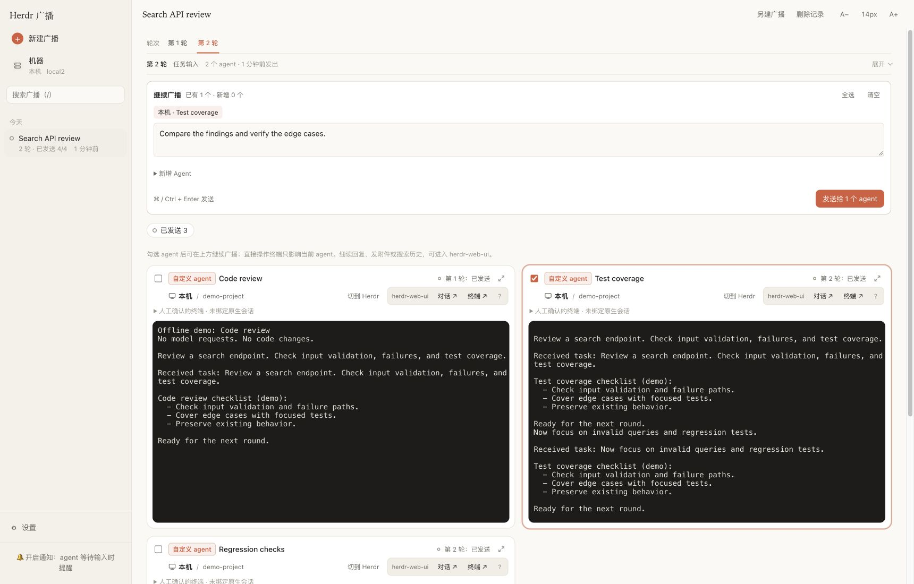

# Herdr Broadcast

**一条指令，多个编程 Agent，在同一个网页查看和操作终端。**

这是一个 [Herdr](https://herdr.dev) 插件，适合比较不同实现、并行处理任务、独立审查代码，再选择需要的 Agent 继续下一轮。支持本机和 Herdr 中保存的 SSH 机器。

[](https://github.com/qivyn/herdr-broadcast/actions/workflows/ci.yml)

[English](README.md) · [版本发布](https://github.com/qivyn/herdr-broadcast/releases) · [反馈问题](https://github.com/qivyn/herdr-broadcast/issues/new)



*界面示例使用离线演示 Agent。当前网页界面为中文。*

## 能做什么

- **把同一条指令发给多个 Agent**：比较实现、拆分工作，或获得独立的审查意见。
- **在同一个任务里多轮协作**：选择已有参与者，也可以新增 Agent，一起接收下一轮指令。
- **实时查看和操作终端**：阅读输出、完成启动确认，或单独给某个 Agent 输入内容。
- **跨机器使用**：同一个任务可以包含本机和 SSH 机器上的 Agent。
- **使用自定义交互式 Agent**：内置选项不包含你的工具时，可以填写启动命令。

内置选项包括 **Claude Code、Codex、Pi、OMP、OpenCode、Kimi、Antigravity、Grok 和 Qwen**。选择机器后，卡片会显示程序是否可用、是否配置了自动识别会话的组件。

## 安装

需要准备：

- **Linux 或 macOS**，每台参与的机器安装 **Herdr 0.9.5+**。
- 运行插件的电脑安装 **Bun 1.4+**。
- 在实际运行 Agent 的机器上安装对应 CLI，并完成登录或模型账号配置。
- 使用自定义 Agent 的进程检查或基于历史记录的会话恢复时，对应机器需要 **Python 3**。

从 GitHub 安装并打开网页服务：

```sh
herdr plugin install qivyn/herdr-broadcast
herdr plugin action invoke qivyn.herdr-broadcast.web
```

打开 **[http://127.0.0.1:7318](http://127.0.0.1:7318)**。如果默认端口已占用，可查看实际地址：

```sh
herdr plugin action invoke qivyn.herdr-broadcast.web-status
```

后续启动 Herdr 时会自动启动网页，除非你关闭了自动启动。插件只安装自身依赖和可选的 Herdr 会话组件，Agent 程序、运行依赖和模型账号需要自行准备。

## 开始第一次广播

1. 打开 **新建广播**，填写要发送的指令。
2. 选择机器、Agent 类型、工作目录和数量，点击 **添加 Agent**。可以添加多组。
3. 点击 **发送**。插件会创建独立终端并启动 Agent，在终端里完成需要的启动或信任确认。

如果内置 Agent 尚未安装会话组件，可以选择安装，也可以暂不安装继续添加。组件帮助识别会话，方便以后找回原对话；未安装时，恢复需要手动选择历史。**管理全部 Agent** 可批量准备所选机器上的组件。

### 在同一个任务里继续

在详情页使用 **继续广播**：勾选已有参与者，也可以展开 **新增 Agent** 添加新的参与者，再发送下一轮。

| 参与者 | 第一轮：创建 A、B | 第二轮：选择 B，新增 C |
| --- | --- | --- |
| A | 收到第一轮指令 | 不收到新指令 |
| B | 收到第一轮指令 | 在原对话里收到第二轮指令 |
| C | 尚未创建 | 新建后只收到第二轮指令 |

侧边栏始终是**一个任务**。历史指令和投递结果保留；切换轮次不会重建终端连接或清空勾选。

### 使用自定义命令

选择 **自定义命令**，填写单行启动命令并添加到任务。启动后进入一个新对话，再点击 **已进入新对话，发送本轮输入**。

插件会新建终端，执行一次命令，并最多等待五分钟让你确认就绪。启动命令不会保存或重放；插件不安装这个 Agent 的软件，也无法验证任意命令是否真的打开了原生新会话。

## 如何理解投递结果

**已发送**只表示指令成功投递到终端，不代表 Agent 已完成工作。正在工作的 Agent 也会立即收到输入，由 Agent 自己处理消息。

失败或结果不确定时，请先检查终端，再明确重试。刷新网页、恢复会话或重启服务都**不会重发旧指令**。关闭浏览器不会停止 Agent；取消、超时或服务停止会结束尚未发送的启动等待。

恢复需要原机器仍保留对应历史。直接在终端输入只影响那个 Agent；如果终端里已有尚未发送的草稿，广播前请先检查。

## 配置与更新

网页默认只监听本机回环地址。使用 **机器** 页面管理 Herdr 保存的 SSH 机器，使用 **设置** 检查新的正式 Release 并手动更新。单独重启服务只会使用当前运行版本。

从手机或其他设备访问前，请先配置认证和允许的主机名，再通过隧道或反向代理访问。详见[配置、会话恢复及命令行参考](docs/usage.md)。

[herdr-web-ui](https://github.com/devswha/herdr-web-ui) 是可选插件。可用时，Agent 卡片可以跳转到其中的同一个对话或终端。

## 文档与贡献

- [使用参考](docs/usage.md)：配置、服务命令、SSH、恢复、CLI 和 HTTP API。
- [开发指南](docs/development.md)：本地开发、架构、验证和发布流程。

欢迎反馈问题和提交 PR。报告问题时，请提供操作系统、Herdr 和 Bun 版本、Agent 类型以及复现步骤；删除不希望公开的指令、终端输出、令牌等私密内容。

## 许可证

[MIT](LICENSE)
